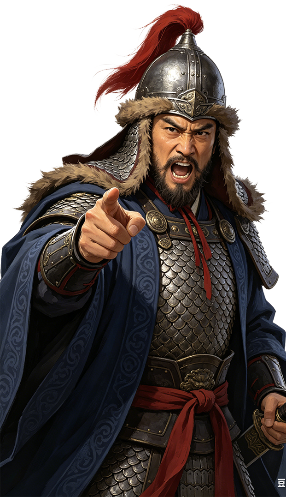

# 胡魁

<figure class="character-portrait" style="float:right; clear:right; width:220px; margin:0 0 1em 1em; padding:4px; border:1px solid #a2a9b1; background:#f8f9fa; text-align:center; font-size:90%; line-height:1.4;">
  
  <figcaption>胡魁</figcaption>
</figure>

胡魁是刘官章麾下的少数民族将领。他在益州统一后从降兵和地方部曲中被提拔，负责满甲营，后参与中央军制和北方战事。

## 出场

- 第8集：作为少数民族小渠帅，与周康、石符、韦石灰一起由基层军官晋升。
- 第10集：统率从常备军中选出的约4000名精锐满甲营，负责重装步兵训练。
- 后续：在中央军政体系中继续任武职；其具体籍贯和部族名，剧情没有交代。
