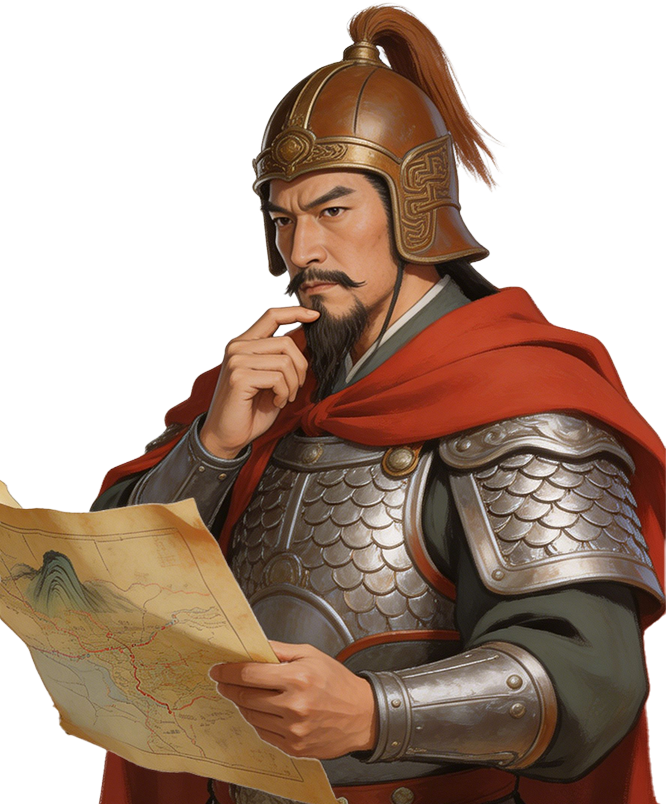

# 黄裳

<figure class="character-portrait" style="float:right; clear:right; width:220px; margin:0 0 1em 1em; padding:4px; border:1px solid #a2a9b1; background:#f8f9fa; text-align:center; font-size:90%; line-height:1.4;">
  
  <figcaption>黄裳</figcaption>
</figure>

**性质**：剧中改编人物  
**剧情出场**：第19、26集

黄裳出身底层，后任吏部侍郎，参与官渡和中央选官。与朱武相比，他代表通过军功、学习和行政能力进入中枢的基层官员。
