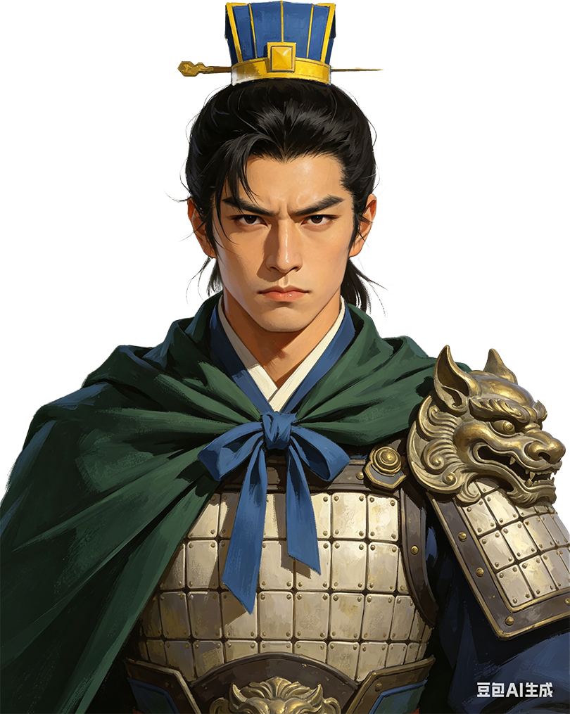

# 韦石灰

<figure class="character-portrait" style="float:right; clear:right; width:220px; margin:0 0 1em 1em; padding:4px; border:1px solid #a2a9b1; background:#f8f9fa; text-align:center; font-size:90%; line-height:1.4;">
  
  <figcaption>韦石灰</figcaption>
</figure>

**性质**：剧中改编人物（少数民族将领、马政负责人）  
**剧情出场**：第8、10、12集

韦石灰是刘官章在益州战后提拔的基层将领。第8集称他原为师长，之后与周康、胡魁、石符一同进入更高层的军政体系。

## 剧中线

- 第8集：作为降军或地方军官体系中的人物被提拔。
- 第10集：负责马政，尝试自行繁育战马，减少对外部马匹贸易的依赖。
- 第12集封官时，韦石灰列入将军体系。

## 相关页面

- [第8集：益州之战](../episodes/ep-08.md)
- [第10集：粮仓大火与对外布局](../episodes/ep-10.md)
- [胡魁](hu-kui.md)
