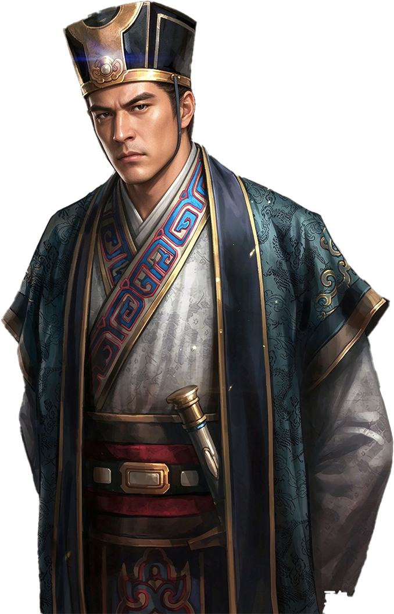

# 司马懿

<figure class="character-portrait" style="float:right; clear:right; width:220px; margin:0 0 1em 1em; padding:4px; border:1px solid #a2a9b1; background:#f8f9fa; text-align:center; font-size:90%; line-height:1.4;">
  
  <figcaption>司马懿</figcaption>
</figure>

**性质**：历史人物
**首次出场**：第23集  
**主要出场**：第23、31、32、36集

---

## 正史记载

> 史料来源：《三国志·魏书·宣帝纪》（卷一，晋书武帝纪旁引）

| 项目 | 内容 |
|------|------|
| 字 | 仲达 |
| 籍贯 | 河内温人（今河南焦作温县） |
| 生卒 | 179–251年 |
| 正史官职 | 魏太尉；其孙司马炎建晋，追封晋宣帝 |

### 正史时间线（《三国志》）

- 初仕曹魏，历任要职，以谋略著称。
- 与诸葛亮多次对阵，多采取坚守不出策略，熬死诸葛亮。
- 239年，曹芳继位，司马懿与曹爽辅政，后发动高平陵之变（249年），彻底掌控曹魏政权。
- 251年卒，孙司马炎建晋，追尊为晋宣帝。

---

## 剧中经历

- 第23集以河内司马氏后辈身份进入政治讨论。刘官章考虑中原世家与新政权的关系时，已经把司马懿视为需要长期观察的人才。
- 司马懿进入安汉大学学习，在嘉禾五年九月以全科第一毕业，成绩待遇与科举状元同级。
- 毕业后直接出任工部屯田司员外郎，为屯田司郎中的副手，秩六百石，换算为新制约正六品上。剧情当时他约三十三岁。
- 刘官章此前已让诸葛亮重点留意司马懿。剧情把三十三岁的司马懿与二十七岁已任尚书左丞的诸葛亮对照，说明两人都进入中央体系，但晋升路径和受重视程度不同。
- 正史中司马懿辅佐曹魏、发动高平陵之变的经历没有发生；剧中曹氏政权已结束，他的仕途从刘官章建立的大学和屯田官署开始。

---

## 相关人物

- [刘官章](../fictional/liu-guanzhang.md)：剧中天子与任用者
- [诸葛亮](zhuge-liang.md)：受命关注司马懿，正史中的主要对手
